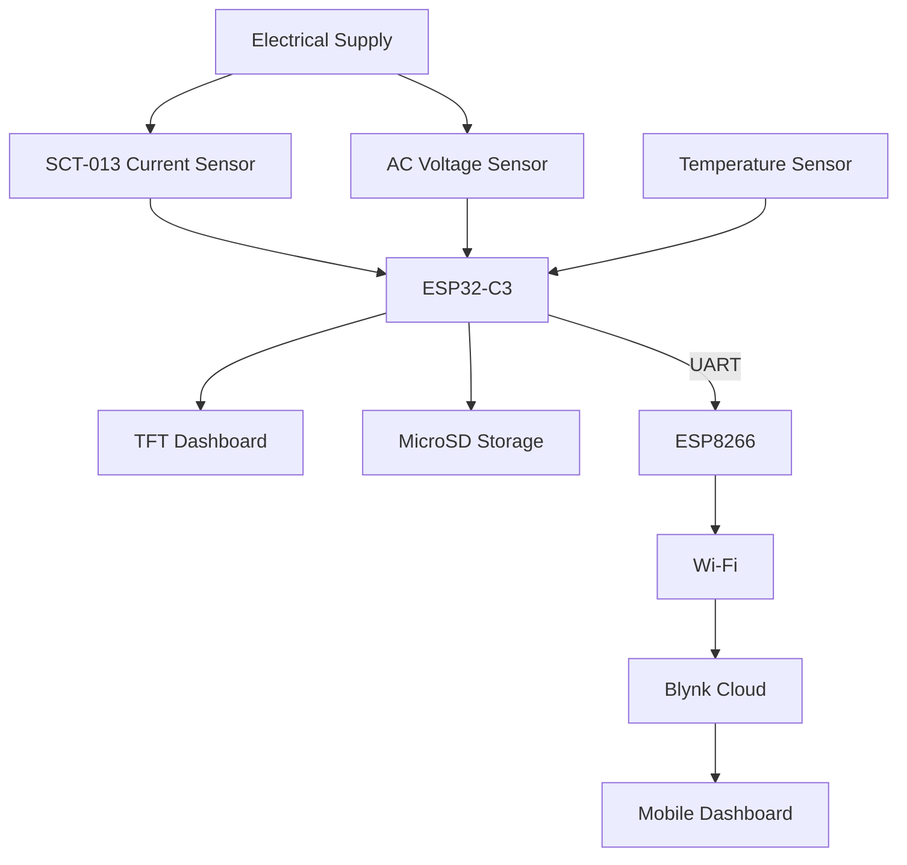
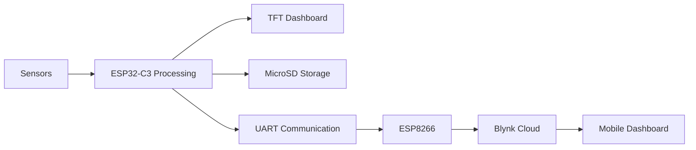
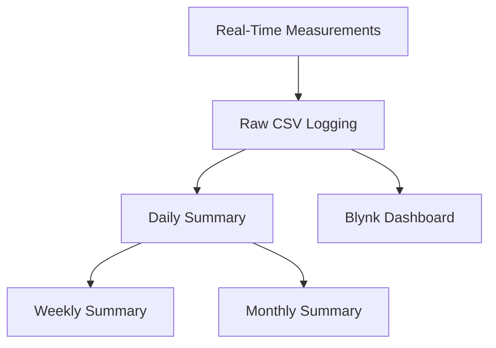

# ⚡ Smart Energy Monitoring & Data Logging System

### IoT-Based Electrical Energy Monitoring, Thermal Monitoring and Data Analytics

Monitor electrical energy consumption and breaker temperature in real time through local visualization, offline CSV storage, and cloud-based analytics using Blynk.


---

## 📖 Overview

The Smart Energy Monitoring & Data Logging System is an IoT-based solution designed to measure, process, store, and visualize electrical energy consumption at a main electrical distribution point.

Unlike conventional plug-in energy meters that monitor individual appliances, this system is designed for monitoring larger electrical installations using non-invasive current sensing technology.

The project adopts a dual-microcontroller architecture.

### ESP32-C3

Responsible for:

- Current measurement using SCT-013
- AC voltage measurement
- Power and energy calculations
- Real-time TFT dashboard visualization
- Historical graph rendering
- CSV logging to MicroSD
- Main breaker temperature monitoring
- Statistical data aggregation

### ESP8266

Responsible for:

- UART communication
- Wi-Fi connectivity
- Blynk cloud synchronization
- Remote dashboard updates

The system continuously records electrical and thermal data in real time, stores raw measurements locally, and generates multi-level summaries for long-term analytics.

The project is currently under prototype development and field testing.

---

## ✨ Key Features

- ⚡ Real-time current and voltage monitoring
- 📊 Apparent and real power calculations
- 🌡 Main breaker temperature monitoring
- 🟢🟡🔴 Thermal status indication
- 📺 TFT graphical dashboard
- 📈 Real-time energy graphs
- 💾 MicroSD CSV logging
- ☁️ Blynk cloud integration
- 📱 Remote mobile monitoring
- 📡 ESP32-C3 ↔ ESP8266 UART communication
- 📊 Daily, weekly, and monthly analytics
- 🔒 Offline operation during Wi-Fi interruptions

---

## 🏗 System Architecture



---

## 🔄 System Workflow



---

## 📡 Data Flow



---

## 🔧 Hardware Components

| Component | Function |
|------------|------------|
| ESP32-C3 | Data processing and logging |
| ESP8266 | Wi-Fi gateway |
| SCT-013 Current Transformer | Current sensing |
| AC Voltage Sensor | Voltage monitoring |
| Temperature Sensor | Breaker thermal monitoring |
| 1.8-inch TFT Display | Local dashboard |
| MicroSD Module | Data logging |
| UART Connection | Inter-controller communication |
| Power Supply | System power source |

---

## 📊 Measured Parameters

| Parameter | Unit |
|------------|--------|
| Current | A |
| Voltage | V |
| Apparent Power | VA |
| Real Power | W |
| Energy Consumption | kWh |
| Breaker Temperature | °C |
| Thermal Status | Green / Yellow / Red |

---

## 🌡 Main Breaker Temperature Monitoring

The system continuously monitors the surface temperature of the main circuit breaker.

Thermal conditions are displayed using color indicators:

| Status | Color | Description |
|----------|----------|----------|
| Cool | 🟢 Green | Normal operation |
| Warm | 🟡 Yellow | Moderate thermal load |
| Hot | 🔴 Red | Elevated temperature condition |

Thermal status updates are displayed in real time on the TFT dashboard and may also be synchronized to the cloud platform.

Temperature thresholds are configurable according to installation requirements.

---

## 📊 Multi-Level Data Analytics

Instead of storing only periodic summaries, the system continuously records measurements and generates higher-level statistics from the collected dataset.

### Real-Time Records

The ESP32-C3 continuously records:

- Voltage
- Current
- Power
- Energy
- Temperature
- Thermal Status

These records form the primary historical dataset.

### Daily Summary

At the end of each day, the system calculates:

- Average Voltage
- Average Current
- Average Power
- Average Temperature
- Total Daily Energy Consumption

### Weekly Summary

Every seven days, the system calculates:

- Average Daily Voltage
- Average Daily Current
- Average Daily Power
- Average Daily Temperature
- Total Weekly Energy Consumption

using the daily summaries.

### Monthly Summary

At the end of each month, the system calculates:

- Average Daily Voltage
- Average Daily Current
- Average Daily Power
- Average Daily Temperature
- Total Monthly Energy Consumption

using all daily records collected throughout the month.

---

## 💾 Data Storage Structure

```text
/data

├── raw_log.csv
├── daily_summary.csv
├── weekly_summary.csv
└── monthly_summary.csv
```

### Real-Time Log Example

```text
Timestamp,Voltage,Current,Power,Energy,Temperature,Status
2026-11-10 08:00,220.4,5.12,1128,1.42,34.5,Cool
```

### Daily Summary Example

```text
Date,AvgVoltage,AvgCurrent,AvgPower,DailyEnergy,AvgTemp
2026-11-10,221.2,4.83,1067,5.7,35.1
```

### Weekly Summary Example

```text
Week,AvgVoltage,AvgCurrent,AvgPower,WeeklyEnergy,AvgTemp
2026-W45,220.9,4.95,1091,39.8,36.2
```

### Monthly Summary Example

```text
Month,AvgVoltage,AvgCurrent,AvgPower,MonthlyEnergy,AvgTemp
2026-11,221.4,5.01,1104,168.5,35.8
```

---

## ☁️ Cloud Monitoring

The ESP8266 periodically synchronizes data to the Blynk platform.

The dashboard displays:

- Current
- Voltage
- Power
- Energy Consumption
- Breaker Temperature
- Thermal Status
- Historical Graphs
- Daily Statistics
- Weekly Statistics
- Monthly Statistics

---

## 📱 Dashboard Preview

```text
docs/tft_dashboard.png

docs/blynk_mobile_dashboard.png

docs/blynk_analytics.png
```

---

## 📂 Project Structure

```text
Smart-Energy-Monitoring/

├── ESP32-C3/
│   ├── SensorAcquisition
│   ├── PowerCalculation
│   ├── TemperatureMonitoring
│   ├── TFTVisualization
│   ├── DataAggregation
│   └── CSVLogger
│
├── ESP8266/
│   ├── UARTReceiver
│   ├── WiFiManager
│   └── BlynkUploader
│
├── hardware/
│   ├── schematic
│   └── pcb
│
├── docs/
│   ├── diagrams
│   ├── screenshots
│   └── reports
│
└── README.md
```

---

## 🚧 Project Status

**Development Stage:** Prototype Development & Field Testing

| Module | Status |
|----------|----------|
| Current Measurement | ✅ Implemented |
| Voltage Measurement | ✅ Implemented |
| Power Calculation | ✅ Implemented |
| Temperature Monitoring | ✅ Implemented |
| TFT Dashboard | ✅ Implemented |
| CSV Data Logging | ✅ Implemented |
| Daily Analytics | ✅ Implemented |
| Weekly Analytics | ✅ Implemented |
| Monthly Analytics | ✅ Implemented |
| UART Communication | ✅ Implemented |
| Cloud Synchronization | ✅ Implemented |
| Calibration | 🚧 Testing |
| Field Validation | 🚧 Ongoing |
| Long-Term Reliability Testing | 🚧 Ongoing |

---

## 🎯 Project Objectives

1. Develop a low-cost energy monitoring solution.
2. Monitor electrical parameters at a main distribution point.
3. Monitor breaker temperature for improved electrical safety.
4. Maintain complete historical records locally.
5. Generate daily, weekly, and monthly consumption reports.
6. Provide both local and remote user interfaces.
7. Support long-term energy consumption analysis.
8. Demonstrate practical IoT applications in energy management.

---

## ⚠️ Safety Notice

This project involves monitoring AC electrical systems.

Installation around mains wiring, electrical distribution boards, or circuit breakers should only be performed by qualified personnel.

The microcontroller subsystem must remain electrically isolated from hazardous voltages.

Current transformers, voltage sensors, temperature sensors, and power supplies should be installed according to their specifications and applicable electrical safety standards.

---

## 🛠 Technologies

- ESP32-C3
- ESP8266
- Arduino Framework
- SCT-013 Current Transformer
- AC Voltage Sensor
- Temperature Sensor
- TFT Display
- MicroSD Storage
- UART Communication
- Wi-Fi
- Blynk IoT Platform

---
## PCB


---

## 📜 License

Apache License 2.0

---

# ⚡ Smart Energy Monitoring & Data Logging System

### Real-Time Monitoring • Thermal Monitoring • Data Analytics • Cloud Integration

Built with ❤️ using ESP32-C3, ESP8266, TFT Display, MicroSD Storage and Blynk IoT.

Energy Intelligence • Thermal Awareness • Reliable Data Collection
