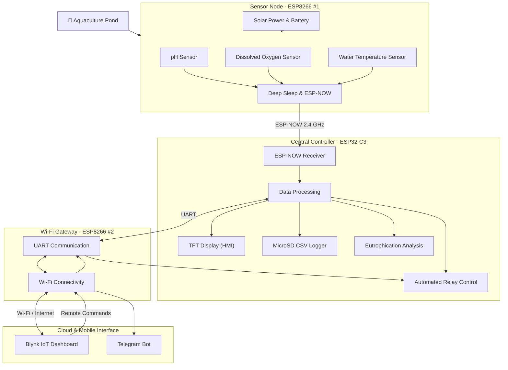

# 🌊 Solar-Powered Smart Aquaculture Monitoring & Automation System

<p align="center">
  <strong>An affordable IoT-based water quality monitoring and automated aeration system for aquaculture ponds.</strong>
</p>

<p align="center">
  
  
  
  
</p>

---

## 📖 Overview

This project aims to develop a cost-effective, solar-powered IoT system for monitoring and controlling water quality in aquaculture ponds.

By combining ESP32-C3 and ESP8266 microcontrollers, the system collects essential water quality parameters, transmits sensor data wirelessly, and automatically controls aeration equipment when dangerous environmental conditions are detected.

Instead of relying on expensive LoRa modules, the system utilizes **ESP-NOW (2.4 GHz)** for wireless communication between devices, reducing hardware costs while maintaining an efficient communication architecture.

The system also integrates cloud connectivity, real-time notifications, historical data logging, and remote control capabilities.

### 🎯 Main Objectives

- Monitor water quality through pH, dissolved oxygen (DO), and temperature sensors.
- Automatically activate aeration equipment when dissolved oxygen reaches dangerous levels.
- Detect potential eutrophication through pH fluctuation analysis.
- Operate independently using solar energy and battery storage.
- Provide real-time monitoring and remote control through IoT platforms.
- Maintain local data records even during Wi-Fi outages.
- Minimize hardware expenses by utilizing affordable microcontrollers and existing components.

---

## 🏗️ System Architecture

The system consists of three primary hardware nodes and a mobile monitoring interface.

| Component | Microcontroller | Primary Responsibility |
|:---|:---|:---|
| Sensor Node | ESP8266 #1 | Water quality monitoring |
| Central Controller | ESP32-C3 | Data processing, HMI, logging, and relay control |
| Wi-Fi Gateway | ESP8266 #2 | Cloud connectivity and remote communication |
| Mobile Interface | Blynk IoT & Telegram | Monitoring, notifications, and remote control |

### Architecture Diagram



---

## ⚙️ Core Features

### 1. 🌡️ Water Quality Monitoring

The sensor node continuously collects essential environmental parameters.

| Parameter | Sensor | Purpose |
|:---|:---|:---|
| pH | Industrial pH Probe | Monitor water acidity and alkalinity |
| Dissolved Oxygen (DO) | DO Sensor | Monitor oxygen availability for aquatic organisms |
| Water Temperature | Temperature Sensor | Monitor water temperature variations |

The collected measurements are transmitted to the central controller for processing and storage.

### 2. 📡 ESP-NOW Wireless Communication

The project uses ESP-NOW as a low-overhead wireless communication protocol between ESP8266 and ESP32-C3 devices.

**Key characteristics:**
- Operates on the 2.4 GHz frequency band.
- Eliminates the need for separate LoRa communication modules.
- Designed for short, periodic wireless data transmissions.
- Reduces unnecessary radio activity to conserve energy.

The proposed sensor node sends measurement packets approximately every 90 minutes, with deep sleep enabled between measurement cycles.

The initial design targets an outdoor communication range of approximately 80–150 meters, depending on environmental and hardware conditions.

### 3. ☀️ Solar-Powered Operation

The sensor node is designed to operate independently using:

- Solar panels.
- Battery storage.
- Battery charging circuitry.
- ESP8266 Deep Sleep mode.

This approach minimizes power consumption and reduces dependence on conventional electrical infrastructure.

### 4. ⚡ Automated Aeration Control

The central ESP32-C3 controller manages the aeration equipment through a relay module.

**Automatic Mode:**

1. Receive water quality measurements.
2. Evaluate the dissolved oxygen level.
3. Activate the aeration relay when DO falls below the configured threshold.
4. Deactivate aeration when the oxygen level returns to the configured safe range.

Example control threshold:

| Condition | Action |
|:---|:---|
| DO below 3.0 mg/L | Activate aeration |
| DO returns to safe range | Deactivate aeration |

Thresholds and switching behavior must be calibrated for the specific aquaculture environment.

**Manual Mode:**

Users can remotely send commands through the Blynk IoT application.

Commands are transmitted through the following communication path:

`Blynk → Wi-Fi Gateway → UART → ESP32-C3 → Relay`

### 5. 🧪 Eutrophication Risk Detection

The system incorporates an early-warning approach to identify potential eutrophication events.

It analyzes daily pH fluctuations alongside dissolved oxygen measurements.

**pH fluctuation calculation:**

```text
ΔpH = Maximum Afternoon pH - Minimum Morning pH
```

The system stores pH measurements over a 24-hour period and evaluates their daily variation.

An initial warning condition is:

- ΔpH exceeds approximately 1.0–1.2.
- Dissolved oxygen drops significantly during early morning hours.

When both conditions occur, the system identifies a potential eutrophication risk and generates an alert.

> This is an early-warning indicator, not a definitive biological diagnosis. Further field testing and calibration are required.

### 6. 💾 Local Data Logging

The ESP32-C3 uses a MicroSD card to maintain historical records in CSV format.

Example filename:

```text
2026_11_11.csv
```

The local logging system allows measurements to remain accessible even when the internet connection is unavailable.

Supported historical analysis targets:

- Hourly measurements.
- 7-day history.
- 30-day history.
- 12-month history.

### 7. 📱 IoT Dashboard & Notifications

The Wi-Fi Gateway connects the local system to external IoT services.

| Platform | Function |
|:---|:---|
| Blynk IoT | Real-time monitoring dashboard |
| Blynk SuperChart | Historical data visualization |
| Blynk Remote Button | Remote aeration control |
| Telegram Bot | Emergency notifications and alerts |

Users can monitor pH, dissolved oxygen, and water temperature remotely.

Telegram notifications are designed to report dangerous DO levels and potential eutrophication conditions.

---

## 🔌 Hardware Components

| Component | Quantity | Role |
|:---|:---:|:---|
| ESP32-C3 | 1 | Central processing and control |
| ESP8266 (ESP-12F / NodeMCU) | 2 | Sensor node and Wi-Fi gateway |
| Industrial pH Probe | 1 | pH measurement |
| Dissolved Oxygen Sensor | 1 | DO measurement |
| Temperature Sensor | 1 | Water temperature measurement |
| TFT Display | 1 | Local HMI |
| MicroSD Module | 1 | Historical data storage |
| Relay Module | 1 | Aeration equipment control |
| Solar Panel | 1 | Renewable energy source |
| Battery & Charging Circuit | 1 set | Energy storage and management |

*Component specifications and quantities are subject to hardware selection and prototype development.*

---

## 🔄 Communication Protocols

| Protocol | Application | Purpose |
|:---|:---|:---|
| ESP-NOW | ESP8266 ↔ ESP32-C3 | Wireless sensor data transmission |
| SPI | ESP32-C3 ↔ TFT / MicroSD | Shared hardware communication bus |
| UART | ESP32-C3 ↔ ESP8266 | Bidirectional serial communication |
| Wi-Fi 802.11 b/g/n | ESP8266 Gateway | Internet connectivity |
| HTTPS / MQTT API | Gateway ↔ IoT Services | Cloud data exchange |

### Shared SPI Bus

To overcome the limited GPIO availability of the ESP32-C3, the TFT display and MicroSD module share the same SPI bus.

The shared connections include:

- MOSI
- MISO
- SCK

Each peripheral uses an independent Chip Select (CS) pin to ensure proper device selection.

---

## 📂 Project Structure

The repository is intended to follow a modular organization:

```text
Aquaculture-IoT/
│
├── README.md
│
├── firmware/
│   ├── sensor-node/
│   │   └── src/
│   │
│   ├── central-controller/
│   │   └── src/
│   │
│   └── wifi-gateway/
│       └── src/
│
├── hardware/
│   ├── schematics/
│   ├── diagrams/
│   └── components.md
│
├── documentation/
│   ├── architecture.md
│   └── testing.md
│
├── data/
│   └── example.csv
│
└── LICENSE
```

*This is a proposed repository structure; directories will be populated as development progresses.*

---

## 🚀 Development Goals

The project is designed to progress through several development stages.

- [ ] Assemble and test the sensor node.
- [ ] Integrate pH, DO, and temperature sensors.
- [ ] Implement ESP-NOW communication.
- [ ] Develop the ESP32-C3 central controller.
- [ ] Implement shared SPI communication.
- [ ] Integrate TFT display and MicroSD logging.
- [ ] Develop automatic and manual relay control.
- [ ] Implement eutrophication risk analysis.
- [ ] Integrate the ESP8266 Wi-Fi Gateway.
- [ ] Connect Blynk IoT and Telegram Bot.
- [ ] Implement solar power management.
- [ ] Conduct real-world testing and calibration.

---

## 🌱 Project Goals & Impact

This project aims to make aquaculture monitoring more accessible through affordable electronics, wireless communication, and renewable energy.

Its main expected benefits include:

- Reduced dependence on expensive wireless communication modules.
- Improved awareness of changing pond water conditions.
- Automated aeration based on dissolved oxygen measurements.
- Reduced reliance on continuous manual monitoring.
- Long-term environmental data collection.
- Improved accessibility through remote monitoring.

---

## 🛠️ Technologies

<p>
  
  
  
  
  
  
</p>

---

## 📌 Project Status

**Development Stage:** System Architecture & Hardware Planning

The system architecture and component distribution have been designed. Hardware integration, firmware development, sensor calibration, and field testing are the next major milestones.

---

## 📄 License

License information will be added when the project is ready for public release.

---

<p align="center">
  <strong>🌊 Smarter Monitoring. Better Aquaculture. Sustainable Technology.</strong>
</p>

<p align="center">
  Made with ❤️ for a more sustainable aquaculture future.
</p>
