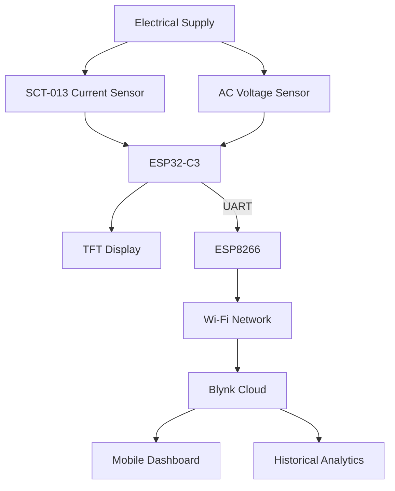
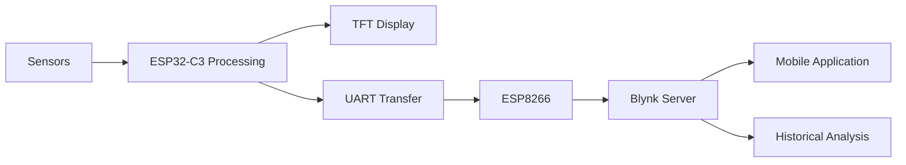
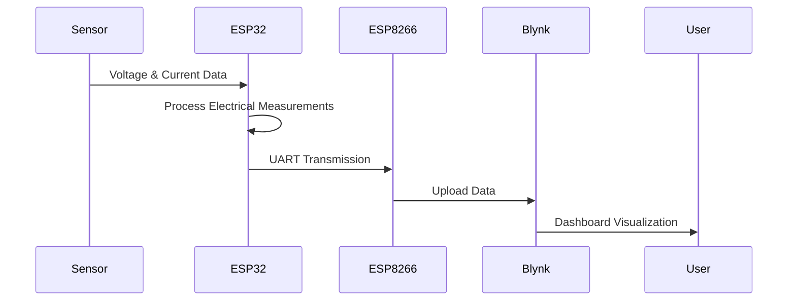

# ⚡ Smart Energy Monitoring System

### IoT-Based Electrical Energy Monitoring using ESP32-C3, ESP8266 and Blynk Cloud

Monitor electrical energy consumption in real time through local visualization and cloud-based analytics.


---

## 📖 Overview

The Smart Energy Monitoring System is an IoT-based solution designed to measure, process, and visualize electrical consumption data at a main electrical distribution point.

Unlike conventional plug-in energy meters that only monitor individual appliances, this system is intended for monitoring larger electrical installations through non-invasive current sensing.

The project utilizes a dual-microcontroller architecture:

- **ESP32-C3** for sensor acquisition, calculation, and local display.
- **ESP8266** for Wi-Fi communication and cloud integration through Blynk.

The collected data is displayed locally and uploaded periodically for remote monitoring and historical analysis.

---

## ✨ Key Features

- ⚡ Real-time current and voltage measurement
- 📊 Apparent and real power calculation
- 🔌 Non-invasive current sensing using SCT-013
- 📺 Local TFT display visualization
- 📡 UART communication between controllers
- ☁️ Blynk cloud integration
- 📱 Mobile dashboard monitoring
- 📈 Historical consumption analysis
- 🕒 90-minute reporting interval
- 📉 Long-term energy trend visualization

---

## 🏗 System Architecture



---

## 🔄 System Workflow



---

## 📡 Data Flow



---

## 🔧 Hardware Components

| Component | Function |
|------------|------------|
| ESP32-C3 | Main controller and data processor |
| ESP8266 | Wi-Fi and cloud communication |
| SCT-013 | AC current measurement |
| AC Voltage Sensor | Voltage monitoring |
| 1.8-inch TFT Display | Local parameter visualization |
| UART Connection | Controller communication |
| Power Supply | System power source |

---

## 📊 Measured Parameters

| Parameter | Unit | Description |
|------------|--------|------------|
| Current | A | Electrical current |
| Voltage | V | AC supply voltage |
| Apparent Power | VA | Voltage × Current |
| Real Power | W | Power considering power factor |
| Energy Consumption | kWh | Accumulated energy usage |

### Apparent Power

```text
S = Voltage × Current
```

Where:

- S = Apparent Power (VA)
- Voltage = RMS Voltage
- Current = RMS Current

### Real Power

```text
P = Voltage × Current × Power Factor
```

Where:

- P = Real Power (W)

---

## ☁️ Cloud Monitoring

The ESP8266 periodically uploads processed measurement data to the Blynk platform.

The dashboard provides:

- Current monitoring
- Voltage monitoring
- Power visualization
- Energy consumption tracking
- Historical graphs
- Consumption trends

---

## 📈 Data Analytics

| Period | Analysis Type |
|----------|----------------|
| Every 90 Minutes | Measurement Update |
| Daily | Daily Consumption |
| Weekly | Average Weekly Usage |
| Monthly | Monthly Trends |
| Yearly | Annual Energy Analysis |

These analytics help users understand long-term energy consumption patterns and identify abnormal loads.

---

## 📱 Dashboard Preview

Add screenshots of your Blynk dashboard here.

```text
/docs/dashboard_mobile.png

/docs/dashboard_graphs.png
```

---

## 📂 Project Structure

```text
Smart-Energy-Monitoring/
│
├── ESP32-C3/
│   ├── SensorAcquisition
│   ├── PowerCalculation
│   └── TFT_Display
│
├── ESP8266/
│   ├── UART_Receiver
│   ├── WiFi_Manager
│   └── Blynk_Uploader
│
├── hardware/
│   ├── schematic
│   └── pcb
│
├── docs/
│   ├── diagrams
│   └── screenshots
│
└── README.md
```

---

## 🚧 Project Status

| Module | Status |
|----------|----------|
| Current Measurement | ✅ Completed |
| Voltage Measurement | ✅ Completed |
| TFT Display | ✅ Completed |
| UART Communication | ✅ Completed |
| Blynk Integration | ✅ Completed |
| Historical Analysis | 🚧 In Progress |
| Fault Detection | 📋 Planned |

---

## 🎯 Project Objectives

1. Develop a low-cost energy monitoring solution.
2. Monitor electrical parameters at a main distribution point.
3. Separate sensing and communication tasks.
4. Provide local and remote monitoring capabilities.
5. Generate useful long-term consumption statistics.
6. Explore practical IoT applications in energy management.

---

## ⚠️ Safety Notice

This project involves interaction with AC electrical systems.

All installation around circuit breakers, distribution boards, or mains wiring should only be performed by qualified personnel.

The microcontroller system must remain electrically isolated from hazardous voltages.

---

## 🚀 Future Improvements

- Power-factor measurement
- More accurate real-power calculation
- Local SD card storage
- Custom web dashboard
- CSV export
- Anomaly detection
- Power outage logging
- Improved offline data buffering
- Predictive energy usage analytics

---

## 🛠 Technologies

- ESP32-C3
- ESP8266
- Arduino Framework
- SCT-013 Current Transformer
- UART Serial Communication
- Wi-Fi
- TFT Display
- Blynk IoT Platform

---

## 📜 License

Apache License 2.0

---

# ⚡ Smart Energy Monitoring System

### Real-Time Monitoring • Cloud Analytics • Energy Intelligence

Built with ❤️ for smarter and more sustainable energy management.
