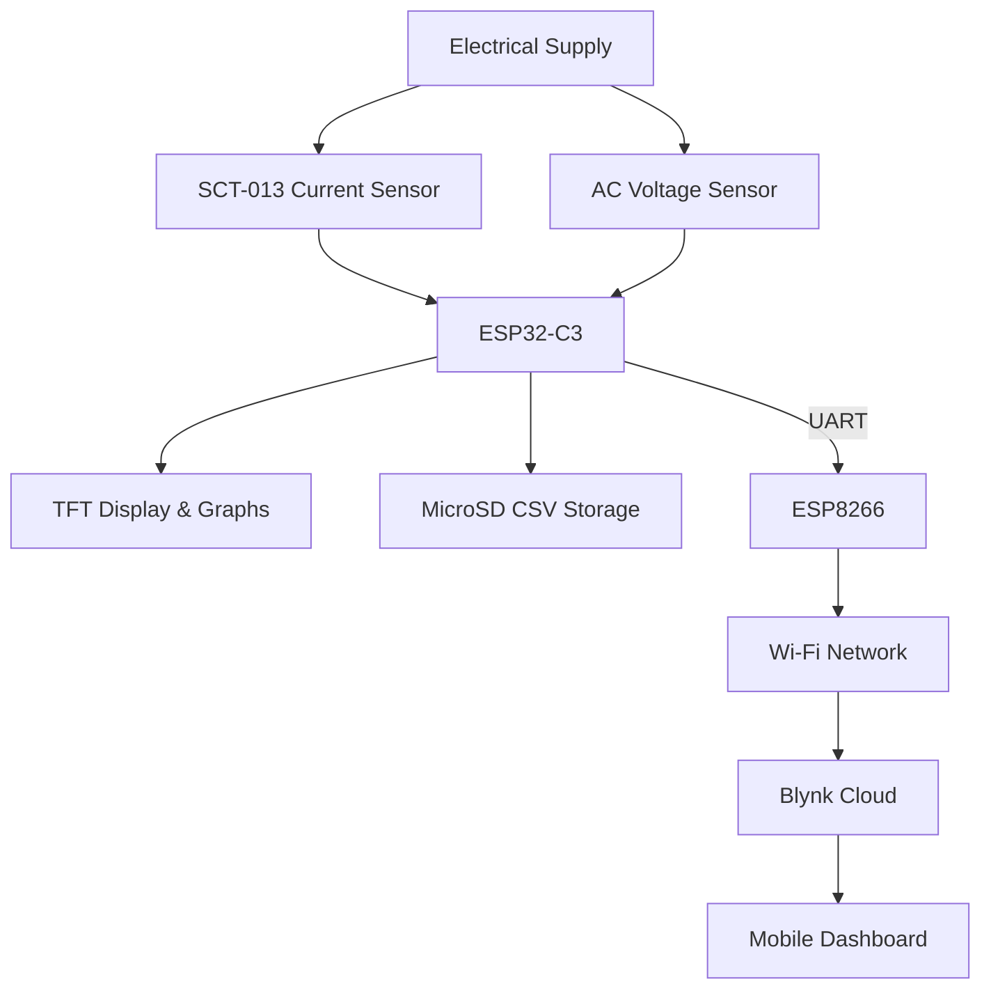
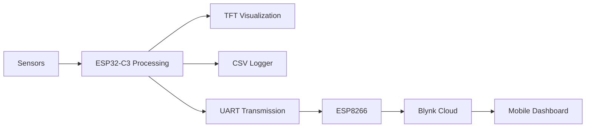
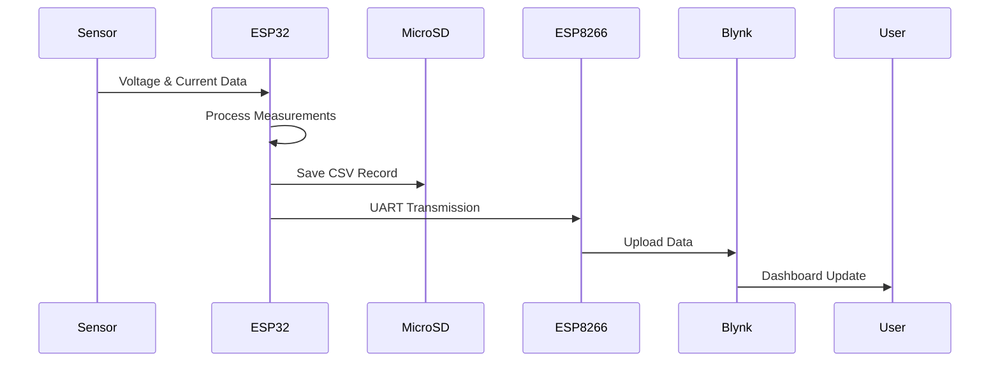

# ⚡ Smart Energy Monitoring & Data Logging System

### IoT-Based Electrical Energy Monitoring with Local Visualization, CSV Logging and Cloud Analytics

Monitor electrical energy consumption in real time through a TFT display, offline CSV storage, and cloud-based monitoring using Blynk.


---

## 📖 Overview

The Smart Energy Monitoring & Data Logging System is an IoT-based solution designed to measure, process, store, and visualize electrical energy consumption at a main electrical distribution point.

Unlike conventional plug-in energy meters that monitor only individual appliances, this system is intended for monitoring larger electrical installations using non-invasive current sensing technology.

The project utilizes a dual-microcontroller architecture:

### ESP32-C3

Responsible for:

- Current acquisition
- Voltage acquisition
- Power and energy calculations
- Real-time TFT visualization
- Historical graph rendering
- CSV logging to MicroSD

### ESP8266

Responsible for:

- UART communication
- Wi-Fi connectivity
- Blynk cloud synchronization
- Remote monitoring services

Measurement data is simultaneously stored locally and uploaded to the cloud, ensuring data availability even when internet connectivity is temporarily unavailable.

---

## ✨ Key Features

- ⚡ Real-time current and voltage monitoring
- 📊 Apparent and real power calculations
- 🔌 Non-invasive current sensing using SCT-013
- 📺 TFT graphical visualization
- 📈 Real-time energy consumption graphs
- 💾 CSV data logging to MicroSD
- ☁️ Blynk cloud synchronization
- 📱 Mobile dashboard monitoring
- 📡 UART communication between ESP32-C3 and ESP8266
- 🕒 90-minute reporting interval
- 🔒 Offline data retention during Wi-Fi outages

---

## 🏗 System Architecture



---

## 🔄 System Workflow



---

## 📡 Data Flow



---

## 🔧 Hardware Components

| Component | Function |
|------------|------------|
| ESP32-C3 | Main processor and data logger |
| ESP8266 | Wi-Fi gateway and cloud communication |
| SCT-013 Current Transformer | Non-invasive current sensing |
| AC Voltage Sensor | Voltage measurement |
| 1.8-inch TFT Display | Real-time local visualization |
| MicroSD Module | Offline CSV storage |
| UART Connection | Communication between controllers |
| Power Supply | System power source |

---

## 📊 Measured Parameters

| Parameter | Unit | Description |
|------------|--------|------------|
| Current | A | RMS electrical current |
| Voltage | V | RMS AC supply voltage |
| Apparent Power | VA | Voltage × Current |
| Real Power | W | Voltage × Current × Power Factor |
| Energy Consumption | kWh | Accumulated energy usage |

### Apparent Power

```text
S = Voltage × Current
```

Where:

- S = Apparent Power (VA)
- Voltage = RMS Voltage
- Current = RMS Current

### Real Power

```text
P = Voltage × Current × Power Factor
```

Where:

- P = Real Power (W)

---

## ☁️ Cloud Monitoring

The ESP8266 periodically uploads processed measurements to the Blynk IoT platform.

The dashboard provides:

- Current monitoring
- Voltage monitoring
- Power monitoring
- Energy consumption tracking
- Historical graphs
- Consumption trend analysis
- Remote accessibility

---

## 📈 Data Analytics

| Period | Analysis Type |
|----------|----------------|
| Every 90 Minutes | Measurement Record |
| Daily | Consumption Statistics |
| Weekly | Average Energy Usage |
| Monthly | Energy Trends |
| Yearly | Long-Term Usage Analysis |

These statistics help identify energy usage patterns and abnormal consumption events.

---

## 💾 Data Reliability

The system employs a dual-storage architecture for improved reliability.

### Local Storage

All measurements are continuously stored on a MicroSD card in CSV format.

Benefits include:

- Offline operation
- Backup data retention
- Historical archives
- Easy spreadsheet analysis
- Protection against cloud outages

Example:

```text
Date,Time,Voltage,Current,Power,Energy
2026-03-15,14:30,220.4,5.12,1128.4,1.42
2026-03-15,16:00,221.1,4.87,1076.7,1.58
```

### Cloud Storage

Processed records are uploaded to Blynk Cloud through the ESP8266.

Benefits include:

- Remote access
- Mobile dashboard visualization
- Historical charting
- Real-time monitoring

The dual-storage design ensures that data remains available even during temporary Wi-Fi interruptions.

---

## 📱 Dashboard Preview

Add screenshots of your Blynk dashboard here.

```text
docs/dashboard_mobile.png
docs/dashboard_graphs.png
```

---

## 📂 Project Structure

```text
Smart-Energy-Monitoring/
│
├── ESP32-C3/
│   ├── SensorAcquisition
│   ├── PowerCalculation
│   ├── TFTVisualization
│   └── CSVLogger
│
├── ESP8266/
│   ├── UARTReceiver
│   ├── WiFiManager
│   └── BlynkUploader
│
├── hardware/
│   ├── schematic
│   └── pcb
│
├── docs/
│   ├── diagrams
│   └── screenshots
│
└── README.md
```

---

## ✅ Project Status

| Module | Status |
|----------|----------|
| Current Measurement | ✅ Completed |
| Voltage Measurement | ✅ Completed |
| Power Calculation | ✅ Completed |
| Energy Monitoring | ✅ Completed |
| TFT Visualization | ✅ Completed |
| Real-Time Graph Rendering | ✅ Completed |
| CSV Data Logging | ✅ Completed |
| UART Communication | ✅ Completed |
| ESP8266 Gateway | ✅ Completed |
| Blynk Integration | ✅ Completed |
| Historical Analytics | ✅ Completed |

---

## 🎯 Project Objectives

1. Develop an affordable electrical energy monitoring solution.
2. Monitor electrical parameters at a main distribution point.
3. Separate processing and communication tasks for improved reliability.
4. Provide both local and remote monitoring interfaces.
5. Maintain historical energy records locally and in the cloud.
6. Demonstrate practical IoT applications in energy management.

---

## ⚠️ Safety Notice

This trical systems.

Installation around mains wiring, electrical distribution boards, or circuit breakers should only be performed by qualified personnel.

The microcontroller subsystem must remain properly isolated from hazardous voltages.

Current transformers, voltage sensors, and power supply circuits should be installed in accordance with their specifications and relevant electrical safety standards.

---

## 🛠 Technologies

- ESP32-C3
- ESP8266
- Arduino Framework
- SCT-013 Current Transformer
- AC Voltage Sensor
- TFT Display
- MicroSD Storage
- UART Serial Communication
- Wi-Fi
- Blynk IoT Platform

---

## 📜 License

Apache License 2.0

---

# ⚡ Smart Energy Monitoring & Data Logging System

### Real-Time Monitoring • Local Data Logging • Cloud Analytics

The system is currently under development and field testing to evaluate measurement accuracy, data reliability, and long-term operational stability.

Built with ❤️ using ESP32-C3, ESP8266, MicroSD Storage and Blynk IoT.

Reliable Monitoring • Offline Backup • Energy Intelligence
