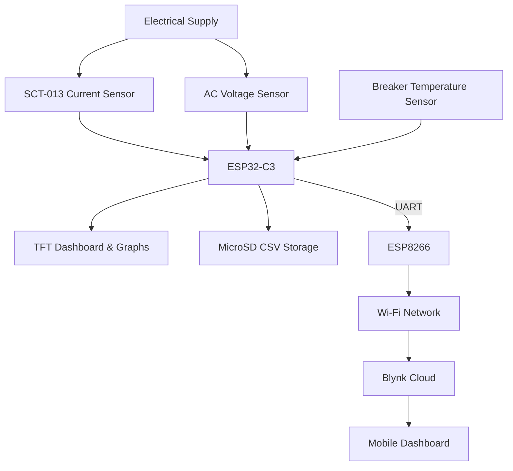
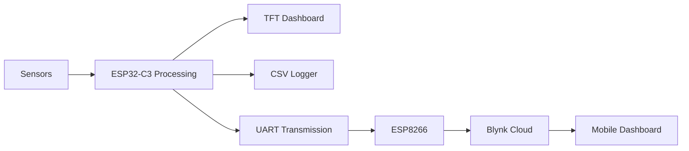
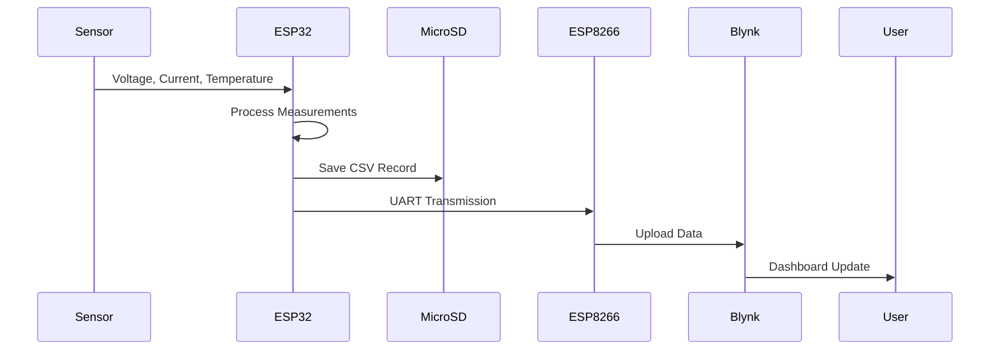

# ⚡ Smart Energy Monitoring & Data Logging System

### IoT-Based Electrical Energy Monitoring, Thermal Monitoring and Cloud Analytics

Monitor electrical energy consumption and breaker temperature in real time through local visualization, offline CSV storage, and cloud-based monitoring using Blynk.


---

## 📖 Overview

The Smart Energy Monitoring & Data Logging System is an IoT-based solution designed to measure, process, store, and visualize electrical energy consumption at a main electrical distribution point.

Unlike conventional plug-in energy meters that monitor individual appliances, this system is intended for monitoring larger electrical installations using non-invasive current sensing technology.

The project adopts a dual-microcontroller architecture.

### ESP32-C3

Responsible for:

- Current measurement using SCT-013
- AC voltage measurement
- Power and energy calculations
- Real-time TFT dashboard visualization
- Historical graph rendering
- CSV data logging to MicroSD
- Main circuit breaker temperature monitoring

### ESP8266

Responsible for:

- UART communication
- Wi-Fi connectivity
- Blynk cloud synchronization
- Remote dashboard updates

Measurement data is simultaneously stored locally and uploaded to the cloud, improving data availability during temporary network interruptions.

The system is currently under prototype development and field testing to evaluate measurement accuracy, thermal monitoring effectiveness, and long-term operational stability.

---

## ✨ Key Features

- ⚡ Real-time current and voltage monitoring
- 📊 Apparent and real power calculations
- 🔌 Non-invasive current sensing using SCT-013
- 🌡 Main breaker temperature monitoring
- 🟢🟡🔴 Thermal load status indication
- 📺 TFT graphical dashboard
- 📈 Real-time energy consumption graphs
- 💾 CSV logging to MicroSD
- ☁️ Blynk cloud synchronization
- 📱 Mobile dashboard monitoring
- 📡 ESP32-C3 ↔ ESP8266 UART communication
- 🔒 Offline data retention during Wi-Fi outages

---

## 🏗 System Architecture



---

## 🔄 System Workflow



---

## 📡 Data Flow



---

## 🔧 Hardware Components

| Component | Function |
|------------|------------|
| ESP32-C3 | Main processor and data logger |
| ESP8266 | Wi-Fi gateway and cloud communication |
| SCT-013 Current Transformer | Non-invasive current sensing |
| AC Voltage Sensor | Voltage measurement |
| Temperature Sensor | Main breaker temperature monitoring |
| 1.8-inch TFT Display | Local dashboard and graph visualization |
| MicroSD Module | Offline CSV storage |
| UART Connection | Communication between controllers |
| Power Supply | System power source |

---

## 📊 Measured Parameters

| Parameter | Unit | Description |
|------------|--------|------------|
| Current | A | RMS electrical current |
| Voltage | V | RMS AC supply voltage |
| Apparent Power | VA | Voltage × Current |
| Real Power* | W | Voltage × Current × Power Factor |
| Energy Consumption | kWh | Accumulated energy usage |
| Breaker Temperature | °C | Surface temperature of main breaker |
| Thermal Status | Green / Yellow / Red | Breaker condition indicator |

\* Real-power accuracy depends on the selected measurement implementation and power-factor calculations.

---

## 🌡 Main Breaker Temperature Monitoring

To improve electrical safety, the system continuously monitors the surface temperature of the main circuit breaker.

The temperature sensor is attached to the breaker enclosure and provides real-time thermal information.

### Thermal Status Indicators

| Status | Indicator | Description |
|----------|----------|----------|
| Cool | 🟢 Green | Normal operating condition |
| Warm | 🟡 Yellow | Elevated thermal load |
| Hot | 🔴 Red | Potential overheating condition |

Thermal status is updated in real time on the TFT dashboard and can also be uploaded to Blynk Cloud for remote monitoring.

Temperature thresholds are configurable and may be adjusted according to breaker specifications and installation conditions.

---

## ⚡ Electrical Power Calculations

### Apparent Power

```text
S = Voltage × Current
```

Where:

- S = Apparent Power (VA)
- Voltage = RMS Voltage
- Current = RMS Current

### Real Power

```text
P = Voltage × Current × Power Factor
```

Where:

- P = Real Power (W)

### Energy Consumption

```text
Energy = Power × Time
```

Reported in:

```text
kWh (Kilowatt-hours)
```

---

## ☁️ Cloud Monitoring

The ESP8266 periodically uploads processed measurement records to the Blynk IoT platform.

The cloud dashboard provides:

- Current monitoring
- Voltage monitoring
- Power monitoring
- Energy consumption tracking
- Breaker temperature monitoring
- Thermal status indication
- Historical graphs
- Consumption trend analysis
- Remote accessibility

---

## 📈 Data Analytics

| Period | Analysis Type |
|----------|----------------|
| Every 90 Minutes | Measurement Record |
| Daily | Consumption Statistics |
| Weekly | Average Energy Usage |
| Monthly | Energy Trends |
| Yearly | Long-Term Usage Analysis |

These statistics help identify energy usage patterns and abnormal consumption events.

---

## 💾 Data Reliability

The system employs a dual-storage architecture for improved reliability.

### Local Storage

All measurements are continuously stored on a MicroSD card in CSV format.

Benefits include:

- Offline operation
- Backup data retention
- Historical archives
- Easy spreadsheet analysis
- Protection against cloud outages

### Example CSV Record

```text
Date,Time,Voltage,Current,Power,Energy,Temperature,Status
2026-03-15,14:30,220.4,5.12,1128.4,1.42,34.5,Cool
2026-03-15,16:00,221.1,4.87,1076.7,1.58,46.2,Warm
2026-03-15,18:00,220.7,8.91,1966.4,1.93,61.8,Hot
```

### Cloud Storage

Processed records are uploaded to Blynk Cloud through the ESP8266.

Benefits include:

- Remote access
- Mobile dashboard visualization
- Historical charting
- Real-time monitoring

The dual-storage design is intended to improve data availability during temporary Wi-Fi interruptions and cloud service outages.

---

## 📱 Dashboard Preview

Add screenshots of your TFT dashboard and Blynk dashboard here.

```text
docs/tft_dashboard.png

docs/blynk_mobile_dashboard.png

docs/blynk_history_graph.png
```

---

## 📂 Project Structure

```text
Smart-Energy-Monitoring/
│
├── ESP32-C3/
│   ├── SensorAcquisition
│   ├── PowerCalculation
│   ├── TemperatureMonitoring
│   ├── TFTVisualization
│   └── CSVLogger
│
├── ESP8266/
│   ├── UARTReceiver
│   ├── WiFiManager
│   └── BlynkUploader
│
├── hardware/
│   ├── schematic
│   └── pcb
│
├── docs/
│   ├── diagrams
│   ├── screenshots
│   └── reports
│
└── README.md
```

---

## 🚧 Project Status

**Development Stage:** Prototype Development & Field Testing

The hardware architecture and firmware framework have been implemented.

The project is currently undergoing calibration, thermal validation, long-term reliability testing, and cloud integration verification.

| Module | Status |
|----------|----------|
| Current Measurement | ✅ Implemented |
| Voltage Measurement | ✅ Implemented |
| Power Calculation | ✅ Implemented |
| Energy Monitoring | ✅ Implemented |
| TFT Visualization | ✅ Implemented |
| Graph Rendering | ✅ Implemented |
| CSV Data Logging | ✅ Implemented |
| Main Breaker Temperature Monitoring | ✅ Implemented |
| UART Communication | ✅ Implemented |
| ESP8266 Gateway | ✅ Implemented |
| Blynk Integration | ✅ Implemented |
| Sensor Calibration | 🚧 Testing |
| Thermal Validation | 🚧 Testing |
| Long-Term Reliability Testing | 🚧 Ongoing |
| Field Deployment Testing | 🚧 Ongoing |

---

## 🎯 Project Objectives

1. Develop an affordable electrical energy monitoring solution.
2. Monitor electrical parameters at a main distribution point.
3. Monitor breaker temperature for improved electrical safety.
4. Separate processing and communication tasks for improved reliability.
5. Provide both local and remote monitoring interfaces.
6. Maintain historical data locally and in the cloud.
7. Support long-term energy consumption analysis.
8. Explore practical IoT applications in energy management.

---

## ⚠️ Safety Notice

This project involves monitoring AC electrical systems.

Installation around mains wiring, electrical distribution boards, or circuit breakers should only be performed by qualified personnel.

The microcontroller subsystem must remain properly isolated from hazardous voltages.

Current transformers, voltage sensors, temperature sensors, and power supply circuits should be installed in accordance with their specifications and relevant electrical safety standards.

---

## 🛠 Technologies

- ESP32-C3
- ESP8266
- Arduino Framework
- SCT-013 Current Transformer
- AC Voltage Sensor
- Temperature Sensor
- TFT Display
- MicroSD Storage
- UART Serial Communication
- Wi-Fi
- Blynk IoT Platform

---

## 📜 License

Apache License 2.0

---

# ⚡ Smart Energy Monitoring & Data Logging System

### Real-Time Monitoring • Thermal Monitoring • Local Data Logging • Cloud Analytics

Built with ❤️ using ESP32-C3, ESP8266, TFT Display, MicroSD Storage and Blynk IoT.

Energy Intelligence • Thermal Awareness • Reliable Data Collection
