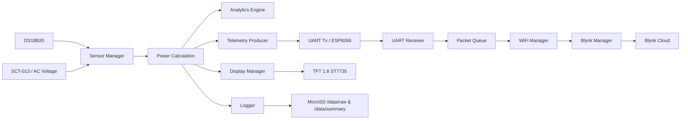

# Smart Energy Monitoring & Analytics System

## 1. System overview

This architecture separates the two MCU responsibilities clearly:

- ESP32-C3 = measurement, analytics, display, storage, and telemetry generation
- ESP8266 = communication gateway, WiFi management, cloud upload, and packet queue management

The measurement and processing path remains active even when the WiFi/cloud path is degraded or offline.

## 2. Module interaction diagram



## 3. Data structures

### Core measurement record

```cpp
struct MeasurementPacket {
  float voltageRms;
  float currentRms;
  float powerWatts;
  float energyKwh;
  float temperatureC;
  ThermalState thermalState;
  uint32_t timestampMs;
};
```

### RMS accumulator

```cpp
struct RmsAccumulator {
  float sumSqVoltage;
  float sumSqCurrent;
  uint32_t sampleCount;
  float maxVoltage;
  float maxCurrent;
};
```

### Graph sample

```cpp
struct GraphSample {
  float value;
  uint32_t timestampMs;
};
```

### Circular graph buffer

```cpp
template <size_t N>
struct GraphBuffer {
  GraphSample samples[N];
  uint16_t head;
  uint16_t count;
};
```

### Daily/weekly/monthly summary

```cpp
struct DailySummary {
  float avgVoltage;
  float avgCurrent;
  float avgPower;
  float avgTemperature;
  float energyKwh;
  uint32_t timestampUnix;
};
```

### UART JSON telemetry packet

```cpp
struct TelemetryPacket {
  float voltage;
  float current;
  float power;
  float energy;
  float temperature;
  char status[12];
  float dailyEnergy;
  float weeklyEnergy;
  float monthlyEnergy;
};
```

### ESP8266 ring queue

```cpp
struct PacketQueue {
  static constexpr size_t kCapacity = 64;
  static constexpr size_t kPacketLength = 256;
  char buffer[kCapacity][kPacketLength];
  uint16_t head;
  uint16_t tail;
  uint16_t count;
};
```

## 4. State machines

### Thermal state machine

```text
NORMAL -> WARM -> HOT
  ^        |        |
  |--------+--------+
        if temperature falls below threshold
```

Transitions:

- GREEN = normal
- YELLOW = warm threshold exceeded
- RED = hot threshold exceeded

Configurable thresholds:

```cpp
constexpr float kThermalWarnC = 45.0f;
constexpr float kThermalHotC = 60.0f;
```

### WiFi state machine

```text
DISCONNECTED -> CONNECTING -> CONNECTED -> DEGRADATED -> RECONNECTING
      ^                                   |
      +-----------------------------------+
```

Behavior:

- continue buffering packets when disconnected
- retry on watchdog timeout
- upload queued packets in FIFO order after reconnect

### SD card state machine

```text
UNINITIALIZED -> READY -> WRITE_ERROR -> RECOVERY -> READY
```

Recovery strategy:

- retry mount
- flush pending buffer
- rotate failed log file safely
- continue local measurement without blocking high-priority tasks

## 5. Task scheduler

The firmware uses non-blocking `millis()` scheduling. This avoids `delay()` and keeps critical measurement acquisition deterministic.

| Task | Interval | Priority |
| --- | --- | --- |
| ADC acquisition | 5-20 ms | High |
| RMS calculation | 200-500 ms | High |
| Thermal update | 500 ms | Medium |
| TFT refresh | 200-500 ms | Medium |
| Graph scroll | 80-200 ms | Medium |
| CSV logging | 1-5 s | Medium |
| Analytics update | 60 s | Low |
| UART telemetry | 500-1000 ms | Medium |
| SD health check | 30 s | Low |
| WiFi watchdog | 5 s | High |

Pseudo scheduler:

```cpp
void loop() {
  const uint32_t now = millis();

  if (now - lastAdcMs >= kAdcIntervalMs) { sampleSensors(); }
  if (now - lastRmsMs >= kRmsIntervalMs) { updateRms(); }
  if (now - lastThermalMs >= kThermalIntervalMs) { updateThermalState(); }
  if (now - lastDisplayMs >= kDisplayIntervalMs) { refreshDashboard(); }
  if (now - lastGraphMs >= kGraphIntervalMs) { renderGraph(); }
  if (now - lastLogMs >= kLogIntervalMs) { writeCsvLog(); }
  if (now - lastAnalyticsMs >= kAnalyticsIntervalMs) { updateAnalytics(); }
  if (now - lastTelemetryMs >= kTelemetryIntervalMs) { transmitTelemetry(); }
  if (now - lastWifiMs >= kWifiCheckIntervalMs) { wifiManager.tick(now); }
}
```

## 6. ESP32-C3 project structure

```text
SmartEnergy_ESP32C3/
  platformio.ini
  include/
    sensor_manager.h
    power_calc.h
    thermal_monitor.h
    display_manager.h
    graph_manager.h
    logger.h
    analytics.h
    telemetry.h
  src/
    main.cpp
    sensor_manager.cpp
    power_calc.cpp
    thermal_monitor.cpp
    display_manager.cpp
    graph_manager.cpp
    logger.cpp
    analytics.cpp
    telemetry.cpp
```

## 7. ESP8266 project structure

```text
SmartEnergy_ESP8266/
  platformio.ini
  include/
    uart_receiver.h
    wifi_manager.h
    blynk_manager.h
    packet_queue.h
  src/
    main.cpp
    uart_receiver.cpp
    wifi_manager.cpp
    blynk_manager.cpp
    packet_queue.cpp
```

## 8. Realtime graph implementation

The graph layer uses a fixed-size circular buffer to maintain a sliding window over recent values. Rendering updates only the changed section of the screen and avoids full-screen redraws when possible.

Key design rules:

- fixed-length buffer per graph page
- one sample per update tick
- horizontal scroll using index modulo buffer length
- plot values scaled against local min/max window
- no flicker via double-buffer or clipped dirty rectangles

Example graph buffer:

```cpp
static constexpr uint16_t kGraphSamples = 180;
struct PowerGraphBuffer {
  float values[kGraphSamples];
  uint16_t head;
  uint16_t count;
};
```

Pages:

- Page 1: system dashboard
- Page 2: power graph
- Page 3: current graph
- Page 4: temperature graph

## 9. CSV logging implementation

CSV files are generated in dedicated folders:

```text
/data/raw/YYYY-MM-DD.csv
/data/summary/daily_summary.csv
/data/summary/weekly_summary.csv
/data/summary/monthly_summary.csv
```

Raw sample format:

```csv
Timestamp,Voltage,Current,Power,Energy,Temperature,Status
2026-11-10 08:00:00,220.4,5.12,1128,1.42,34.5,GREEN
```

The logger writes a single line per sample, with a watchdog-safe flush strategy. If a write fails, the system keeps sampling and retries the next interval.

## 10. Analytics implementation

Analytics are generated from the measurement stream, not from instantaneous values alone.

Daily summary:

- average voltage
- average current
- average power
- average temperature
- daily energy consumption

Weekly and monthly summaries are calculated from aggregated daily values. These summaries can be stored in daily_summary.csv, weekly_summary.csv, and monthly_summary.csv.

## 11. UART communication implementation

Telemetry packet sequence:

1. gather measurement snapshot from `PowerCalc` and `ThermalMonitor`
2. serialize to compact JSON with no whitespace
3. append newline
4. transmit over UART without blocking
5. validate packet CRC or fields on receive side

Example payload:

```json
{"voltage":220.4,"current":5.12,"power":1128,"energy":1.42,"temperature":34.5,"status":"GREEN","daily_energy":4.5,"weekly_energy":31.4,"monthly_energy":128.7}
```

## 12. Blynk integration

Virtual pins on the ESP8266:

- V0 = Voltage
- V1 = Current
- V2 = Power
- V3 = Energy
- V4 = Temperature
- V5 = Thermal Status
- V6 = Daily Energy
- V7 = Weekly Energy
- V8 = Monthly Energy

Blynk is treated as a best-effort uploader. Missing or degraded cloud connectivity does not halt sampling on the ESP32-C3.

## 13. Error handling

Common failure modes:

- SD card absent or corrupted
- UART framing errors
- JSON parse failure
- WiFi disconnect or AP not found
- Blynk server timeout
- sensor invalid or stuck values

Error handling approach:

- keep task loops non-blocking
- use bounded retry counters
- maintain stale sample threshold
- expose system health state on display
- log errors to serial and optional SD

## 14. SD card failure recovery

Strategy:

1. detect mount failure
2. retry mount in a backoff window
3. queue raw samples locally in memory if the SD is unavailable
4. delay log writes until media is healthy again
5. do not block the measurement loop

## 15. WiFi reconnection logic

The ESP8266 keeps a watchdog timer and reconnects automatically when WiFi is lost. During downtime, packet queue entries remain in the ring buffer and are transmitted in order after the connection is restored.

## 16. 24/7 reliability recommendations

- use fixed-size buffers only
- avoid heap-based containers in the hot path
- reserve watchdog timers for each subsystem
- keep RTC/clock synchronization enabled for timestamp correctness
- use monotonically increasing task counters and bounds checks
- separate sensor sampling from network uplink timing
- keep the logger append-only and safe against power loss
- use CRC or checksum validation on UART telemetry
- keep logs rotate-friendly and compact
- physically isolate ADC and current transformer circuits from noisy digital lines
- provide brownout-safe startup and SD recovery logic

## 17. Implementation principle

The measurement subsystem must continue working even when the WiFi/cloud subsystem is unavailable. The ESP32-C3 remains the source of truth for measurements; the ESP8266 only relays and uploads them.
